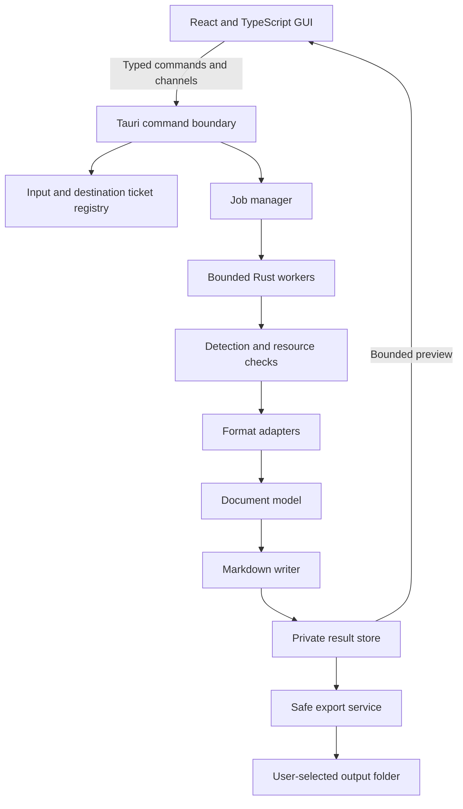

# implement.md — Rust Document-to-Markdown Desktop Application

**Platform:** Windows 11 x64  
**Stack:** Tauri 2, Rust, TypeScript, Tailwind CSS, shadcn/ui  
**Selected release scope:** Core documents first; OCR as an optional later extension.

**Delivery status:** This is the complete proposed document content. Plan mode prohibits writing files, so a downloadable `implement.md` has not been created. When file creation is enabled, save this document as UTF-8 to `outputs/implement.md` and provide a direct download link.

## 1. Product requirements and release scope

### 1.1 Objective

Build a GUI-first Windows application that converts local documents into readable Markdown for searching, note-taking, and downstream text processing.

Microsoft’s [MarkItDown repository](https://github.com/microsoft/markitdown) is the functional reference. Its emphasis is document content and structure rather than visually faithful reproduction. This application independently implements a narrower, explicitly tested format set in Rust.

A user must be able to install the application, add files, convert them, inspect results, and export Markdown without opening a terminal.

### 1.2 Non-negotiable implementation constraints

- All document decoding, parsing, extraction, normalization, and Markdown generation run in Rust.
- No Python source, interpreter, embedded runtime, pip, virtual environment, Python service, or Python sidecar.
- No conversion subprocesses, including Rust converter executables.
- No Pandoc, LibreOffice automation, Microsoft Office automation, Tesseract executable, PDFium, Poppler, MuPDF, or Ghostscript conversion dependency.
- No JavaScript document-conversion fallback. TypeScript handles presentation and interaction.
- No document uploads, cloud conversion, account requirement, telemetry, or automatic network retrieval.
- Conversion must work offline immediately after installation.
- Application development, CI, packaging, and supported maintenance scripts must not require Python.

“Rust-only conversion” also excludes Rust wrappers around native C/C++ conversion engines. Windows APIs, the MSVC toolchain, and Tauri’s WebView2 GUI dependency are allowed platform infrastructure. Node.js is a development dependency, not a shipped application service.

### 1.3 First-release format contract

Extensions are case-insensitive. A supported extension alone does not establish that a file is valid.

| Input | v1 status | Required Markdown behavior | Explicit limitation |
|---|---|---|---|
| `.txt` | Supported | Preserve text, paragraphs, and line breaks; escape accidental Markdown syntax | No heading inference |
| `.md`, `.markdown` | Supported | Preserve Markdown, normalizing encoding and line endings | Preview suppresses active content and image loading |
| `.csv`, `.tsv` | Supported | Convert records to tables or row-oriented sections | No spreadsheet formula execution |
| `.json` | Supported | Validate syntax and preserve source in a `json` fenced block | No automatic schema interpretation |
| `.xml` | Supported | Validate permitted XML and preserve source in an `xml` fenced block | DTDs and external entities rejected |
| `.html`, `.htm` | Supported, static content | Headings, paragraphs, lists, links, code, and simple tables | No scripts, CSS layout, remote resources, or JavaScript-rendered content |
| `.docx` | Supported, defined subset | Body paragraphs, headings, emphasis, lists, hyperlinks, simple tables, footnotes/endnotes | Layout fidelity, drawings, charts, equations, and embedded objects are outside the fidelity contract |
| `.xlsx` | Supported, values-oriented | Worksheet sections and cell values, with explicit formula limitations | No recalculation, macros, chart rendering, or exact Excel formatting |
| `.pdf` | Supported, text-bearing subset | Page-ordered extracted text with page markers and warnings | Reading order, complex tables, and typography are best effort |

Additional rules:

- Empty valid inputs produce an explicit empty-document result; they are not confused with extraction failure.
- Scanned PDFs with no usable text return `OCR_REQUIRED`, with no misleading successful empty export.
- Mixed text/scanned PDFs may produce partial results only with prominent page-specific warnings.
- Encrypted or password-protected documents are unsupported in v1. Do not provide a password field that the backend cannot honor.
- DOCX and XLSX ZIP containers are supported internally; arbitrary `.zip` conversion is not.
- Files containing unexpected macro-enabled Office content are rejected, even if renamed to a supported extension.

### 1.4 Later releases

| Stage | Formats/features | Conditions |
|---|---|---|
| v1.1 | `.pptx` | Slide text, basic tables, and optional notes; separate fidelity corpus |
| v1.1 | `.epub` | Unencrypted EPUB, spine order, static XHTML conversion |
| v1.1 | `.xls`, `.xlsb`, `.ods` | Calamine adapter validation for each format |
| Optional OCR release | `.png`, `.jpg`, `.jpeg` | Approved local models and validated Rust inference |
| Optional PDF OCR release | Scanned and mixed PDFs | Independently validated pure-Rust rasterization and OCR |

Excluded from this implementation program: legacy `.doc`/`.ppt`, email archives, audio/video transcription, YouTube URLs, website crawling, arbitrary archive traversal, cloud AI descriptions, plugins executing third-party code, PDF editing, and a public CLI.

### 1.5 Output contract

- Export one `.md` file per input.
- UTF-8 without BOM, LF line endings, and one final newline.
- Use CommonMark-compatible Markdown plus GFM tables.
- Do not insert absolute source paths, usernames, timestamps, or machine-specific metadata into document content.
- Preserve source order wherever that order is defined.
- Never silently truncate exported content.
- Generate escaped text placeholders for unsupported embedded objects; do not invent descriptions.
- Do not extract or export image assets in v1.
- Preserve literal JSON/XML source within fences after validation, avoiding numeric rounding and mixed-content changes.
- Choose fence length dynamically so embedded backticks cannot terminate the block.
- Deterministic output means identical document bytes and options produce identical Markdown bytes under the same converter version.

## 2. Architecture, adapters, and conversion behavior

### 2.1 Architecture



Responsibilities:

- **Frontend:** queue presentation, options, progress, preview, accessibility, error recovery, and export interaction.
- **Tauri boundary:** command authorization, request validation, native dialogs, OS integration, and transport.
- **Conversion core:** format detection, parsing, document representation, Markdown emission, warnings, and limits.
- **Job manager:** scheduling, cancellation, lifecycle state, resource accounting, and progress snapshots.
- **Storage services:** temporary results, safe exports, settings, and cleanup.

The conversion core must compile and run tests without linking Tauri or opening a window.

Use ordinary Rust libraries compiled into the application. No localhost HTTP server and no converter process are required.

### 2.2 Frontend decisions

Use:

- React with strict TypeScript.
- Vite for development and frontend builds.
- Tailwind CSS through the Vite integration.
- shadcn/ui components stored in the application source.
- React context/reducers for the initial application state.
- `react-markdown` with `remark-gfm` for presentation only.
- Vitest and React Testing Library for component tests.

The current [shadcn/ui Vite instructions](https://ui.shadcn.com/docs/installation/vite) document the Tailwind Vite integration. Pin the tested package versions and generated component source instead of rerunning an unpinned generator during production builds.

### 2.3 Rust dependency decisions and validation gates

The following are selected implementation candidates, not claims that integration or fidelity has already been demonstrated.

| Responsibility | Selected approach | Validation required |
|---|---|---|
| Text decoding | Rust standard library and `encoding_rs` | BOM handling, strict decoding, Turkish characters, invalid sequences |
| CSV/TSV | `csv` | Quoted delimiters, multiline records, ragged rows, large fields |
| JSON | `serde_json` validation with number-preserving configuration | Very large integers, nesting, invalid syntax, source preservation |
| XML | `quick-xml` | Depth limits, entity policy, declared encoding, malformed input |
| HTML | `htmd` inside a controlled adapter | Tables, nested lists, code fences, excluded elements, unsafe URLs |
| OOXML packages | `zip` and `quick-xml` | Package relationships, decompression limits, duplicate entries, compression features |
| DOCX | Purpose-built OOXML reader | Style resolution, numbering, notes, tables, revisions |
| XLSX | `calamine` | Sparse sheets, allocation behavior, cached formulas, dates, merged cells |
| PDF text | `pdf-extract`, with compatible `lopdf` access where needed | Fonts, CMaps, page extraction, text order, encrypted input, allocation behavior |
| Markdown parsing/normalization | `pulldown-cmark` and an application-owned writer | GFM tables, escaping, round-trip behavior |
| Scheduling | Tokio, semaphore, cooperative cancellation | Blocking work never runs on the UI thread |
| Serialization/errors | `serde`, `thiserror` | Stable error codes and IPC compatibility |
| Temporary storage | `tempfile` plus Windows-aware export handling | Restricted location, cleanup, collision safety |

Supporting primary documentation:

- [CSV reader and configuration](https://docs.rs/csv/latest/csv/)
- [Encoding implementation and behavior](https://docs.rs/encoding_rs/latest/encoding_rs/)
- [quick-xml](https://github.com/tafia/quick-xml)
- [htmd API](https://docs.rs/htmd/latest/htmd/)
- [Calamine](https://github.com/tafia/calamine)
- [pdf-extract](https://github.com/jrmuizel/pdf-extract)
- [lopdf](https://github.com/J-F-Liu/lopdf)
- [pulldown-cmark](https://docs.rs/pulldown-cmark/latest/pulldown_cmark/)

`docx-rs` is an evaluation alternative, not the baseline adapter. It has a documented [`read_docx` API](https://docs.rs/docx-rs/latest/docx_rs/fn.read_docx.html), but API availability does not establish coverage of the required DOCX subset.

If a selected candidate fails a mandatory gate, correct the integration or maintain an audited Rust patch. Do not silently replace it with a prohibited engine or remove a required v1 format.

### 2.4 Dependency purity verification

Inspect the resolved dependency graph and enabled features, not only top-level crate descriptions.

For every shipped conversion dependency:

1. Record exact version, source, license, enabled features, and minimum Rust version.
2. Inspect build scripts, native linking, optional engines, and subprocess invocation.
3. Inspect all transitive dependencies for the Windows release target.
4. Disable unnecessary default features.
5. Build on a machine without Python or installed converter tools.
6. Inspect the packaged payload and observe conversion-time process creation.

ZIP configuration requires particular care. Its manifest exposes multiple compression backends, including native alternatives; selecting a Rust crate alone does not prove a pure-Rust dependency graph. Use only the tested stored/Deflate functionality required by the accepted OOXML corpus. [ZIP manifest](https://raw.githubusercontent.com/zip-rs/zip2/master/Cargo.toml)

Cargo feature unification must be reviewed across all dependencies and duplicate crate versions. A second dependency can re-enable features disabled by the direct dependency.

### 2.5 Module structure

The following is the proposed repository layout, not an existing implementation:

```text
app/
  src/
    app/                  # Application shell and state
    features/
      intake/             # Add files/folders and queue
      conversion/         # Options, progress, cancellation
      preview/            # Rendered and source views
      export/             # Destination and export results
      settings/
    components/ui/        # shadcn/ui source
    lib/ipc/              # Typed transport and event reconciliation

  src-tauri/
    src/
      commands/           # Narrow Tauri handlers
      state/              # Registries and managed state
      platform/           # Windows dialogs and integration
    capabilities/

  crates/
    conversion-core/
      src/
        detect/
        adapters/
          text/
          structured/
          html/
          docx/
          spreadsheet/
          pdf/
        document/
        markdown/
        limits/
        diagnostics/
    conversion-jobs/
      src/
        scheduler/
        cancellation/
        progress/
        result_store/
        export/
    ipc-contract/
    xtask/                # Rust developer and verification tasks

  tests/
    fixtures/
    golden/
    integration/
    desktop/
    security/
  docs/
```

Dependency direction:

- `conversion-core` has no frontend, Tauri, or platform-dialog dependency.
- `conversion-jobs` depends on the core.
- `src-tauri` depends on the jobs and IPC crates.
- Frontend imports only the documented TypeScript transport surface.
- Adapter-specific library types never cross IPC.

### 2.6 Internal document representation

Use an application-owned intermediate model:

- `Document`: metadata, ordered blocks, diagnostics.
- `Block`: heading, paragraph, list, quote, code block, table, page marker, section, unsupported-content placeholder.
- `Inline`: text, emphasis, strong emphasis, code, link, line break.
- `SourceLocation`: page, worksheet/cell range, paragraph, or package part.
- `Diagnostic`: stable code, severity, message parameters, source location.

Keep the model independent of any specific parser.

HTML output may be parsed into the model through `pulldown-cmark`. Markdown input uses a preservation path so it is not unnecessarily rewritten.

Warnings belong to the result metadata. Material omissions also receive a short visible marker in the exported document at the affected location.

### 2.7 Conversion pipeline

1. **Acquire input:** a native file dialog or native drop event grants access to selected files.
2. **Issue tickets:** the backend stores paths/handles and returns opaque input IDs.
3. **Enumerate folders:** if explicitly selected, walk within the chosen root using configured limits.
4. **Preflight:** check size, accessibility, encoding clues, signature, container identity, and resource limits.
5. **Create jobs:** freeze input options and enqueue validated requests.
6. **Read a bounded snapshot:** parse a consistent input snapshot; detect changes during acquisition.
7. **Parse:** select the adapter from validated format identity.
8. **Extract:** produce ordered content and diagnostics.
9. **Normalize:** apply conservative whitespace and document-structure rules.
10. **Render:** emit Markdown through the shared writer.
11. **Commit result:** store complete output in the private result store.
12. **Preview:** retrieve a bounded result slice.
13. **Export:** write the selected result to an authorized destination.
14. **Cleanup:** release input resources and remove expired temporary results.

Input selection does not start conversion automatically.

One failed document must not stop unrelated jobs.

### 2.8 Format-specific behavior

**Text and encoding**

- Auto mode accepts UTF-8 and BOM-marked UTF-16LE/BE.
- Offer explicit Windows-1252 and Windows-1254 decoding for supported text inputs.
- Invalid decoding produces an actionable error; do not silently replace characters.
- Preserve Unicode content without forced Unicode normalization.

**CSV/TSV**

- `.csv` defaults to comma; `.tsv` defaults to tab.
- Allow explicit comma, semicolon, or tab override.
- Treat the first row as data by default, using generated column headings.
- Provide a “First row contains headings” option.
- Escape pipes and Markdown syntax in cells.
- Render up to 20 columns as a table; wider records become labeled row sections.
- Preserve all accepted rows. Ragged rows produce warnings and deterministic padding.

**JSON/XML**

- Validate, then preserve the decoded source in a fenced block.
- Do not pretty-print by default.
- Reject XML DTDs and external entities.
- Preserve JSON numeric literals without conversion through floating-point storage.

**HTML**

- Convert static body content.
- Exclude scripts, styles, templates, embedded frames, and executable content.
- Convert images to escaped alt-text placeholders.
- Preserve safe HTTP(S) links without fetching them.
- Render unsupported or unsafe link destinations as plain text with diagnostics.
- Resolve no remote resources or local linked files.

**DOCX**

- Resolve package parts through content types and relationships.
- Read body paragraphs in XML order.
- Resolve heading styles and basic style inheritance.
- Interpret list definitions and nesting.
- Include normal text and inserted revisions; omit deleted revisions and emit a revisions warning.
- Represent simple tables directly.
- Flatten merged/nested tables conservatively with warnings.
- Append referenced footnotes and endnotes.
- Exclude headers, footers, comments, floating text boxes, and drawing content from the fidelity contract; warn when detected.
- Never execute fields or fetch external relationship targets.

**XLSX**

- Preserve workbook worksheet order.
- Include visible sheets by default; expose an option for hidden sheets.
- Read cached values; never calculate formulas.
- Where a formula has no cached value, emit the formula as literal text and a warning.
- Warn that cached formula results may be stale.
- Use coordinate-based column headings rather than assuming the first data row is a header.
- Preserve sheet offsets, internal blank cells, cell errors, and merged-cell anchors.
- Normalize dates only when the cell type/format supports reliable interpretation; otherwise retain the stored value with a warning.
- Warn when formatting such as leading-zero number formats cannot be faithfully reproduced.
- Do not render charts, pivot tables, or embedded images.

### 2.9 PDF strategy and limitations

PDF is a release-critical engineering spike.

Text may be stored as individually positioned glyphs with incomplete Unicode mappings and no logical paragraph or reading order. Columns, repeated headers, rotated text, ligatures, bidirectional scripts, tables, and subset fonts require separate validation.

The baseline PDF adapter must:

- Extract per-page text where supported by the pinned library API.
- Preserve page order and insert `<!-- page N -->` markers.
- Keep conservative line structure rather than guessing headings or tables.
- Track pages with no usable text and decoding anomalies.
- Reject encrypted input in v1.
- Return `OCR_REQUIRED` when no usable text can be extracted.
- Emit `PAGE_TEXT_MISSING`, `TEXT_DECODING_UNCERTAIN`, or `PDF_LAYOUT_BEST_EFFORT` as appropriate.
- Avoid describing every empty page as scanned; genuinely blank pages are possible.
- Never claim faithful table reconstruction or universal reading-order accuracy.

`pdf-extract` documents text extraction and currently declares a `lopdf` dependency. That verifies a candidate implementation path, not PDF fidelity or bounded memory use. [pdf-extract manifest](https://raw.githubusercontent.com/jrmuizel/pdf-extract/master/Cargo.toml)

Release acceptance must distinguish:

- Simple text PDFs that meet strict extraction checks.
- Complex PDFs that produce useful output with explicit limitations.
- Inputs that fail clearly without deceptive success.

### 2.10 Optional pure-Rust OCR

OCR is outside the first-release acceptance criteria.

**Image OCR path**

```text
PNG/JPEG → Rust decoder → bounded image preprocessing
         → ocrs + RTen → ordered text → document model → Markdown
```

Use the `ocrs` library in process. Do not invoke its CLI or inherit automatic model-download behavior.

The upstream project describes an early-preview OCR engine with Latin-alphabet support. That does not establish reliable Turkish diacritics, handwriting, or multilingual recognition. [ocrs documentation](https://raw.githubusercontent.com/robertknight/ocrs/main/README.md)

RTen documents Rust inference and CPU execution. Its example workflows may include Python-based model export; those workflows are excluded from this application. Consume already prepared, approved model artifacts only. [RTen documentation](https://raw.githubusercontent.com/robertknight/rten/main/README.md)

**Model requirements**

- Fixed model identifiers and cryptographic hashes.
- Explicit weight licenses and redistribution rights.
- Recorded recognition alphabet and tested languages.
- Known-compatible runtime and model versions.
- Local installation through an approved model pack.
- No arbitrary model execution, automatic downloads, or user-supplied model support initially.
- No training or model-format conversion step requiring Python.

Pretrained ONNX and RTen artifacts are available upstream, but availability alone does not establish permission to redistribute a particular file. [Model project](https://raw.githubusercontent.com/robertknight/ocrs-models/main/README.md)

**Scanned-PDF path**

```text
PDF → validated pure-Rust page rasterizer
    → bounded page bitmap → OCR → page-tagged Markdown
```

Evaluate `hayro` as the first rasterization candidate. Its upstream documentation identifies it as experimental and lists rendering/performance limitations. It must pass a separate Windows build, license, dependency, codec, and fidelity review. [hayro documentation](https://raw.githubusercontent.com/LaurenzV/hayro/main/README.md)

Do not treat extracting a PDF’s embedded images as general page rendering: images may be tiled, masked, transformed, or combined with other content.

If rasterizer validation fails, retain image OCR only and keep scanned-PDF OCR unavailable. Do not introduce a native fallback.

## 3. GUI, IPC contracts, and job lifecycle

### 3.1 Main workflow

The main window contains:

- **Toolbar:** Add files, Add folder, Convert, Cancel batch, Export selected.
- **Queue:** filename, detected format, size, status, progress, warnings, and row actions.
- **Preview:** rendered Markdown and source tabs.
- **Details panel:** format-specific options and diagnostic explanations.
- **Footer:** completed/failed counts and local-processing status.

Default flow:

1. Add files.
2. Review readiness and format warnings.
3. Convert.
4. Inspect the result.
5. Export selected results to a chosen folder.

Do not require users to choose parser libraries, configure runtimes, or understand package internals.

### 3.2 UX requirements

- Drag-and-drop and native file dialogs are equally supported.
- Add folder includes supported descendants and reports skipped files.
- Duplicate selections are identified before conversion.
- Queue supports filtering by failed, warning, completed, and pending.
- Retry creates a new attempt without erasing the previous diagnostic.
- Cancelling one file does not cancel others.
- Progress uses real measurable units where available and an indeterminate indicator otherwise.
- Avoid fabricated percentages and unreliable completion estimates.
- Conversion and export are separate visible states.
- Export failures leave conversion results available for retry.
- Preview truncation is labeled and never affects exported content.
- Source preview is read-only in v1.
- Closing during active work offers “Keep working” or “Cancel and close.”
- No persistent conversion history by default.

Accessibility:

- Complete keyboard workflow and visible focus.
- `Ctrl+O` to add files; `Ctrl+Enter` to convert.
- Accessible status announcements without excessive repetition.
- Status conveyed by text and icons, not color alone.
- Dark/light/system themes.
- Usable at 200% scaling and 1024×768.
- English UI initially; strings organized for later localization.
- Test Turkish filenames and text regardless of UI language.

### 3.3 IPC design

Use Tauri commands for operations and a typed channel for job updates. Tauri documents both command invocation and Rust-to-frontend communication. [Commands](https://v2.tauri.app/develop/calling-rust/), [frontend communication](https://v2.tauri.app/develop/calling-frontend/)

Use camelCase JSON fields, string IDs, tagged unions, and structured errors.

The renderer must not receive a general “read any path,” “write any path,” or “run command” API.

| Command | Purpose |
|---|---|
| `get_capabilities` | Return protocol version, available formats, limits, and OCR availability |
| `pick_inputs` | Open native file/folder picker and register selected inputs |
| `list_inputs` | Return registered input summaries, including native-drop additions |
| `remove_inputs` | Release unused input tickets |
| `start_batch` | Validate requests and create a batch |
| `watch_batch` | Attach a progress channel and return an authoritative snapshot |
| `get_batch` | Recover current state after reload or missed updates |
| `cancel_jobs` | Request cancellation for specified jobs or an entire batch |
| `read_result` | Return a bounded Markdown slice and diagnostics |
| `pick_output_directory` | Register an authorized export destination |
| `export_results` | Export completed results with per-file outcomes |
| `copy_result` | Copy bounded plain Markdown text to the clipboard |
| `reveal_export` | Reveal a previously exported file through a validated backend record |
| `discard_results` | Remove explicitly discarded temporary results |
| `get_settings`, `update_settings` | Read/write validated application preferences |

Native drop events are processed by the Rust-side integration. A frontend-supplied path must never create an input ticket by itself.

### 3.4 Contract sketch

```ts
type InputId = string;
type BatchId = string;
type JobId = string;
type ResultId = string;
type DestinationId = string;

type JobState =
  | "queued"
  | "validating"
  | "extracting"
  | "normalizing"
  | "rendering"
  | "storing"
  | "cancelling"
  | "succeeded"
  | "succeededWithWarnings"
  | "failed"
  | "cancelled";

interface ConversionOptions {
  textEncoding: "auto" | "utf-8" | "windows-1252" | "windows-1254";
  delimiter: "extensionDefault" | "comma" | "semicolon" | "tab";
  firstRowIsHeader: boolean;
  includeHiddenSheets: boolean;
}

interface StartBatchRequest {
  protocolVersion: 1;
  requestId: string;
  jobs: Array<{
    inputId: InputId;
    options: ConversionOptions;
  }>;
}

interface Diagnostic {
  code: string;
  severity: "info" | "warning" | "error";
  message: string;
  location?: {
    page?: number;
    sheet?: string;
    cell?: string;
    paragraph?: number;
  };
}

interface Progress {
  stage: string;
  completedUnits: number | null;
  totalUnits: number | null;
  unit: "bytes" | "pages" | "rows" | "parts" | null;
}

interface JobSnapshot {
  jobId: JobId;
  inputId: InputId;
  state: JobState;
  progress: Progress;
  resultId: ResultId | null;
  diagnostics: Diagnostic[];
}

interface BatchSnapshot {
  protocolVersion: 1;
  batchId: BatchId;
  sequence: number;
  jobs: JobSnapshot[];
}

interface JobUpdate {
  protocolVersion: 1;
  batchId: BatchId;
  sequence: number;
  job: JobSnapshot;
}

interface AppError {
  code: string;
  message: string;
  retryable: boolean;
  diagnosticId: string;
}
```

Contract rules:

- Rust types are authoritative; use generated TypeScript DTOs through an audited Rust tool such as `ts-rs`.
- Add round-trip contract tests for every tagged union and representative error.
- Validate all options in Rust, including options irrelevant to a selected format.
- Do not expose stack traces or raw document text in IPC errors.
- Repeated `requestId` values with identical content return the existing batch; conflicting reuse is rejected.
- Allocate monotonic sequence numbers in the backend.
- Register the watcher and capture its initial snapshot atomically.
- Ignore stale frontend updates and recover through `get_batch`.
- Channel disconnection does not cancel conversion.
- Progress messages contain metadata, not repeated document content.

Initial error codes include:

`UNSUPPORTED_FORMAT`, `FORMAT_MISMATCH`, `INVALID_ENCODING`, `INPUT_CHANGED`, `PASSWORD_PROTECTED`, `OCR_REQUIRED`, `MALFORMED_DOCUMENT`, `RESOURCE_LIMIT`, `ACCESS_DENIED`, `DISK_FULL`, `EXPORT_FAILED`, and `INTERNAL_ERROR`.

### 3.5 Concurrency and cancellation

- Default to two concurrent conversion jobs.
- Allow only one PDF or Office parsing job at a time initially.
- Acquire worker permits before scheduling blocking work.
- Check cancellation between reads, XML events, records, pages, and output chunks where the adapter permits.
- A cancellation request moves a running job to `cancelling`.
- Do not mark it `cancelled` or release its worker permit until execution has actually returned.
- Queued jobs cancel immediately.
- Cancelled jobs expose no exportable partial result.

A started Tokio blocking task cannot be forcibly stopped by aborting its handle. A timeout wrapper does not terminate the parser. This limitation must be reflected in both implementation and UI. [Tokio blocking-task documentation](https://docs.rs/tokio/latest/tokio/task/fn.spawn_blocking.html)

For an uninterruptible parser call:

- Keep the UI responsive.
- Display that cancellation is waiting for the current operation.
- Suppress output publication after cancellation.
- Do not spawn replacement work beyond the concurrency limit.
- Offer application exit if the user chooses to terminate all work.

Catch recoverable Rust panics at the job boundary where appropriate, but do not present panic handling as protection against allocation failure, stack overflow, or process termination.

## 4. Security, privacy, storage, and packaging

### 4.1 Security boundary

Treat documents, filenames, links, archive entries, and parser output as untrusted.

Tauri capabilities control frontend access but do not sandbox Rust conversion code. Registered application commands require explicit attention: Tauri documents that custom commands are available to application windows by default unless command permissions are configured. Declare commands through `AppManifest::commands`, grant only required permissions to the main window, and validate access inside handlers. [Tauri capabilities](https://v2.tauri.app/security/capabilities/)

Requirements:

- One trusted bundled application window.
- No remote frontend content, arbitrary navigation, or untrusted iframe.
- No frontend shell, generic filesystem, HTTP, or process permission.
- No dynamic JavaScript execution.
- Production CSP allows required bundled assets and Tauri IPC endpoints only.
- No wildcard network destinations.
- Preview renders Markdown through safe React components, with raw HTML disabled.
- Image components display placeholders and never fetch remote or local URLs.
- Links do not navigate the WebView. Provide copying of validated destinations in v1.
- Clipboard operations require an explicit user action.

`react-markdown` is a suitable presentation component, but custom plugins and components must preserve its security assumptions. [react-markdown documentation](https://github.com/remarkjs/react-markdown)

### 4.2 Filesystem and container handling

- Authorize inputs and destinations through native selection or drop events.
- Resolve final paths using Windows-aware handling.
- Reject device paths, alternate data streams, and network-share inputs in v1.
- Do not follow junctions or symbolic links during folder traversal.
- Detect source changes while obtaining the input snapshot.
- Never modify source files.
- Do not extract archive entries to arbitrary filesystem paths.
- Reject absolute entries, traversal segments, duplicate normalized names, and encrypted ZIP entries.
- Allow package relationships only within the validated package.
- Record external relationships as links or omissions; never retrieve them.
- Enforce actual decompressed-byte limits while reading, rather than trusting ZIP metadata.

### 4.3 Initial resource policy

These are product defaults to validate during the engineering spikes, not measured performance claims.

| Resource | Initial limit |
|---|---:|
| Files per batch | 500 |
| Enumerated directory entries | 10,000 |
| Folder recursion depth | 32 |
| Plain text/HTML/JSON/XML/CSV input | 20 MiB |
| PDF/DOCX/XLSX input | 100 MiB |
| ZIP entries | 10,000 |
| Total uncompressed package data | 256 MiB |
| Individual uncompressed package part | 64 MiB |
| XML/JSON nesting depth | 128 |
| PDF pages | 1,000 |
| Spreadsheet cells visited | 1,000,000 per job |
| Markdown output per job | 32 MiB |
| Temporary result store | 1 GiB |
| Preview payload | 256 KiB per request |
| Clipboard result | 1 MiB |
| Progress frequency | At most 10 updates/second/job |
| Soft job deadline | 120 seconds |

Exceeding a limit produces a clear diagnostic and no silently incomplete export.

Application-level counters are not hard process memory limits. Some parser libraries allocate internally before returning control. Audit these paths, apply preflight checks, and patch or reject unsafe behavior discovered by the corpus.

The no-sidecar requirement means v1 cannot promise hard per-document process isolation or guaranteed termination of hostile parsers.

### 4.4 Export integrity

- The user chooses an output folder through a native dialog.
- Default naming is `source-name.md`, then `source-name (2).md`, and so on.
- v1 never overwrites an existing file.
- Sanitize Windows reserved names, trailing dots/spaces, and invalid filename characters.
- Handle collisions case-insensitively.
- Stage the output on the destination volume.
- Flush and commit using a Windows-safe no-clobber operation.
- Recheck destination safety during commit.
- If another process claims the filename, choose the next suffix.
- Do not report success until the final output exists and its byte count/hash matches the staged result.
- Report export outcomes per file so disk-full or permission failures do not obscure successful exports.

### 4.5 Privacy and retention

- No application-initiated network requests in v1.
- No analytics, crash upload, model download, or automatic update check.
- Logs contain diagnostic IDs, adapter names, durations, and error codes.
- Document text and full paths are excluded from logs.
- Session results live under a user-specific application cache with appropriate filesystem permissions.
- Delete results when discarded and on normal exit.
- On startup, remove abandoned session caches safely.
- Cache deletion is ordinary deletion; do not claim secure erasure.
- Persist only preferences such as theme and window size by default.
- Diagnostic export is explicit and redacted.
- Do not claim that local processing prevents Windows, backup software, or user-selected synced folders from handling files.

### 4.6 Windows packaging

Primary delivery:

- Signed Windows x64 NSIS installer.
- Standard-user installation where supported by the tested installer configuration.
- Bundled frontend assets.
- No console window during normal use.
- No conversion sidecar or runtime download.
- Start Menu entry and normal uninstall support.

Use Tauri’s WebView2 `offlineInstaller` option so installation can succeed without an internet connection. WebView2 remains a GUI platform dependency and increases package size. Tauri also supports MSI packaging; MSI is deferred unless enterprise deployment requires it. [Windows installer documentation](https://v2.tauri.app/distribute/windows-installer/)

Build on Windows using the MSVC target. Node/package-manager tooling, Rust, Windows SDK, and installer tools are build requirements only.

Additional requirements:

- Pin the Rust toolchain, package manager, Cargo lockfile, and frontend lockfile.
- Record dependency and compiler versions in release metadata.
- Authenticode-sign and timestamp release executables/installers.
- Keep signing credentials in protected release infrastructure.
- Publish installer checksums, release notes, notices, and an SBOM.
- Do not enable the updater plugin in v1.
- Test upgrades without deleting exported documents.
- Uninstall removes installed binaries while preserving user exports.
- Windows ARM64 and Windows 10 compatibility are outside the initial release claim.

### 4.7 License review

Do not approve redistribution from a crate’s short description alone.

Create a dependency register containing:

- Exact crate/package version and source.
- SPDX expression and selected license alternative.
- Required notices and attribution.
- Transitive native components, if any.
- Bundled fonts/icons and copied UI component licenses.
- Model-weight licenses separately from inference-engine licenses.
- Fixture provenance and permission to distribute test documents.

The reviewed manifests declare MIT for `pdf-extract` and Calamine, and MIT-or-Apache-2.0 choices for `ocrs`, RTen, and the hayro workspace. These observations apply to the inspected manifests; the actual locked release must be reviewed again. [PDF manifest](https://raw.githubusercontent.com/jrmuizel/pdf-extract/master/Cargo.toml), [Calamine manifest](https://raw.githubusercontent.com/tafia/calamine/master/Cargo.toml), [ocrs manifest](https://raw.githubusercontent.com/robertknight/ocrs/main/ocrs/Cargo.toml), [RTen manifest](https://raw.githubusercontent.com/robertknight/rten/main/Cargo.toml), [hayro manifest](https://raw.githubusercontent.com/LaurenzV/hayro/main/Cargo.toml)

Default dependency policy:

- Accept reviewed permissive licenses with required notices.
- Block unknown, incompatible, or restrictive dependencies pending explicit review.
- Run Rust license/advisory checks and a frontend dependency audit.
- Include `THIRD_PARTY_NOTICES` in the installer.
- Use original branding; do not imply Microsoft affiliation.
- Do not copy MarkItDown implementation code as part of this plan.

## 5. Validation, milestones, and completion criteria

### 5.1 What has been verified for this plan

Documentation and source-manifest review confirms:

- MarkItDown’s purpose and broader format range.
- Tauri 2 commands, channels, capability behavior, and Windows packaging options.
- Rust candidate libraries for the proposed extraction pipeline.
- A documented DOCX reading API in `docx-rs`.
- Rust OCR inference candidates and upstream model artifacts.
- A pure-Rust PDF rasterization candidate with explicit maturity caveats.
- The inability to forcibly abort an already running Tokio blocking task.

This planning pass did **not** compile the dependency graph, inspect a finished binary, benchmark conversions, verify model redistribution rights, or demonstrate document fidelity.

Repository `main` manifests are moving targets and may describe unreleased versions. Select published stable releases, record exact pins, and complete the following gates before making product claims.

### 5.2 Test strategy

**Unit tests**

- Markdown escaping, fence selection, table emission, and deterministic whitespace.
- Encoding detection and explicit Windows code pages.
- Type detection and extension/signature mismatch.
- DOCX style and numbering resolution.
- Spreadsheet coordinate mapping and formula diagnostics.
- Cancellation state transitions.
- Resource counters and destination filename selection.
- IPC serialization and error mapping.

**Golden conversion tests**

Maintain reviewed source documents and expected outputs.

Minimum corpus:

- At least five normal fixtures per supported extension family.
- At least 30 DOCX fixtures covering the promised subset and known omissions.
- At least 30 XLSX fixtures covering values, formulas, dates, sparse cells, and merged cells.
- At least 50 PDFs split across simple text, complex layout, missing mappings, mixed pages, scanned input, and encryption.
- Turkish text including `İ`, `ı`, `Ş`, `ş`, `Ğ`, `ğ`, `Ç`, `ç`, `Ö`, `ö`, `Ü`, and `ü`.

Use exact golden comparisons for deterministic supported structures. For PDFs, combine reviewed outputs with normalized text checks and human review; do not equate successful parsing with accurate extraction.

**Security and malformed-input tests**

- ZIP traversal, duplicate entries, deceptive sizes, and decompression bombs.
- XML entity expansion attempts and excessive nesting.
- JSON depth and extreme numeric literals.
- HTML scripts, event handlers, unsafe links, and tracking images.
- Malformed PDF objects, compressed streams, and broken cross-reference structures.
- Huge declared spreadsheet ranges and sparse-cell allocation attacks.
- Renamed macro-enabled Office files.
- Windows device/ADS paths, junctions, Unicode names, and destination races.
- Disk-full, access-denied, deleted input, and input mutation.
- Frontend attempts to invoke unauthorized commands or forge tickets.

**GUI tests**

- Complete add → convert → preview → export workflow.
- Keyboard-only operation, focus restoration, and screen-reader labels.
- Mixed success/failure batch.
- Cancellation of queued and active jobs.
- Preview truncation labels.
- Retry export after disk or permission failure.
- Dark/light themes and display scaling.

Use frontend tests for component behavior and Tauri WebDriver integration on Windows for real IPC/application flows. Tauri documents Windows WebDriver support; native dialogs and drag/drop also require manual packaged-app checks. [Tauri WebDriver](https://v2.tauri.app/develop/tests/webdriver/)

**Packaging and offline tests**

On a clean Windows VM:

- No Python, pip, Node.js, Rust, Office, or converter tools installed.
- Network disabled.
- Install, launch, convert every supported format, export, upgrade, and uninstall.
- Repeat with WebView2 absent to verify the offline prerequisite path.
- Monitor conversion-time child processes and application network activity.
- Inspect payloads and loaded modules for prohibited dependencies.

### 5.3 Performance and cancellation targets

Measure release builds on a documented Windows 11 x64 reference machine with four CPU cores, 16 GiB RAM, and SSD storage.

Initial acceptance targets:

- First usable window within five seconds on the reference machine.
- Queue interaction and cancellation acknowledgement within 250 ms during conversion.
- No persistent UI freeze during batch work.
- Process private memory below 1 GiB on the standard non-OCR corpus.
- Conversion of a 100-file mixed sample completes without continuing memory growth across repeated runs.
- Cooperative adapters stop within one second of their next cancellation checkpoint.
- Uninterruptible parser behavior is separately recorded; do not misreport it as satisfying hard cancellation.
- Exported output remains complete even when preview is bounded.

Record per-format median and p95 conversion times. Establish throughput budgets from the representative corpus before the beta milestone; do not invent a universal documents-per-second claim.

### 5.4 Milestones and exit gates

| Milestone | Work | Exit gate |
|---|---|---|
| M0 — Feasibility and dependency lock | Resolve stable versions; inspect features/licenses; spike DOCX, XLSX, PDF; audit allocations | All mandatory adapters compile on Windows without Python/native conversion engines; corpus risks documented |
| M1 — GUI and contracts | Tauri shell, React layout, tickets, queue, typed IPC, job snapshots | GUI-driven text conversion, preview, cancellation, and export work end to end |
| M2 — Core text formats | TXT/Markdown, CSV/TSV, JSON/XML, HTML, shared writer | Golden corpus passes; unsafe preview content cannot execute or fetch resources |
| M3 — Office and PDF | DOCX subset, XLSX values, PDF text, diagnostics | Required fidelity cases pass; omissions and unsupported inputs are accurately reported |
| M4 — Hardening | Resource checks, malformed inputs, race handling, accessibility, recovery | Security regression suite and repeated batch tests pass |
| M5 — Windows release | Installer, signing, notices, SBOM, offline and upgrade testing | Clean-machine acceptance passes; release artifacts are reviewable |
| M6 — Optional OCR | Approved models, image OCR, renderer evaluation | Separate OCR quality/license/purity gates pass; otherwise feature stays unavailable |

M0 precedes substantial adapter development. OCR must not delay M5.

### 5.5 First-release acceptance checklist

The release is complete only when all conditions hold:

- [ ] All ordinary operations are available through the GUI.
- [ ] Every v1 format meets its explicit subset contract.
- [ ] No Python is required for building, testing, packaging, installing, or running the application’s supported workflow.
- [ ] All conversion executes in process using the approved Rust dependency graph.
- [ ] No conversion sidecars or external converter tools are present.
- [ ] Offline install and conversion pass on a clean Windows VM.
- [ ] Scanned PDFs report OCR requirements instead of successful empty output.
- [ ] Complex PDFs and unsupported Office content produce visible limitations.
- [ ] Spreadsheet formulas are never executed or silently described as recalculated.
- [ ] Preview cannot execute source content or load document-linked resources.
- [ ] Cancellation and progress reflect actual worker state.
- [ ] Failed exports are retryable without reconversion.
- [ ] Export never silently truncates output or overwrites existing files.
- [ ] Tests cover Turkish content and Windows-specific paths.
- [ ] Dependency purity, security advisories, licenses, and notices are reviewed.
- [ ] Signed installer, checksums, SBOM, and release notes are produced.
- [ ] Actual packaged-app behavior is tested; a successful build alone is insufficient.

### 5.6 Final deliverables

**Planning deliverable**

- English `implement.md`, containing this complete specification.
- Saved as a standalone UTF-8 Markdown file when file creation is available.
- Direct downloadable file link.
- No claim that the application itself has been implemented.

**Application deliverables after implementation**

- Tauri/React application source and Rust conversion crates.
- Locked build configuration and Python-free setup instructions.
- Fixture corpus, golden outputs, and automated tests.
- Format support and limitation documentation.
- Dependency, license, and security review records.
- Signed Windows installer with checksum.
- SBOM and third-party notices.
- Clean-machine verification report and measured performance results.

### 5.7 Recorded defaults

- Core document formats in v1, as selected by the user.
- OCR deferred and optional, as selected by the user.
- Windows 11 x64 is the initial supported platform.
- English UI with localization-ready strings.
- Local-only operation; no account or cloud features.
- Read-only previews and explicit export.
- One Markdown file per source document.
- No output overwrite.
- No persistent document history.
- Pure-Rust conversion dependencies; Windows GUI infrastructure remains permitted.
- Exact package versions become fixed at M0 after compatibility and release validation.
